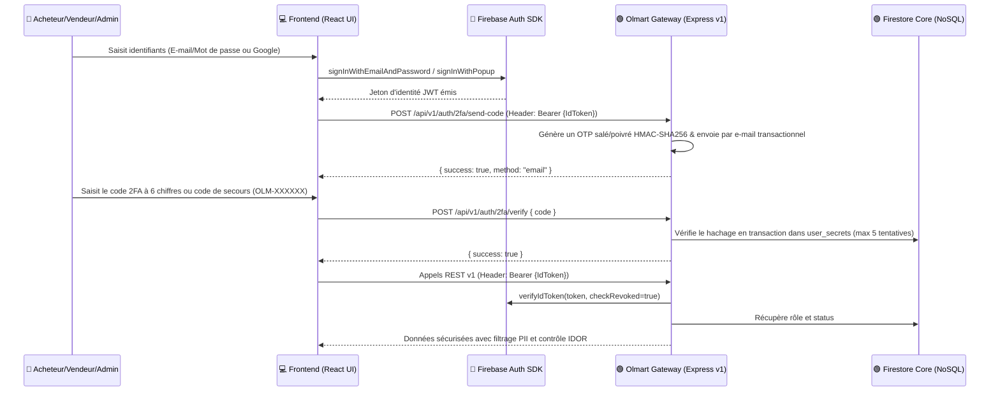

# Flux d'Authentification & RBAC (Anti-Desync Iframe)

Ce document détaille le processus d'enrôlement, d'accès sécurisé avec double authentification (2FA) par e-mail et le mécanisme de maintien de session par en-tête `Authorization: Bearer <Token>` conçu pour contourner les restrictions d'iframe tierces.

---

## 🔐 1. DIAGRAMME DE SÉQUENCE DE L'AUTHENTIFICATION & 2FA

---

## 🔒 2. INTERCEPTEUR DE RÉCONCILIATION RÉSEAU (ANTI-DESYNC COOKIES)

Puisque Olmart s'exécute dans une iframe, l'usage des cookies de session traditionnels est désactivé. L'authentification est maintenue grâce à l'injection dynamique :

1.  **En-tête d'autorisation :** Le client React intercepte chaque requête sortante de l'API pour injecter l'en-tête `Authorization: Bearer <JWT>`.
2.  **Vérification de Révocation :** Le serveur Express vérifie l'intégrité du jeton via `verifyIdToken(idToken, true)`.

---

## 🛡️ 3. RÔLES ET PRIVILÈGES DU SYSTÈME (RBAC MATRICE)

| Rôle | Portée d'accès | Droits d'écriture critiques |
| :--- | :--- | :--- |
| **Acheteur (`buyer`)** | Catalogue public, commandes personnelles, profil, litiges personnels | Création de commande, ouverture de litige, annulation |
| **Vendeur (`seller`)** | Boutique propre, gestion des produits, commandes reçues | Ajout/édition de produit, validation expédition, KYC |
| **Artisan (`artisan`)** | Profil artisan, devis Bricolage, chantiers | Réponse aux appels d'offres et publication de devis |
| **Annonceur (`property_owner`)** | Annonces immobilières, visites Olma Immo | Publication d'annonces vérifiées |
| **Administrateur (`admin`)**| Console d'administration globale, arbitrage des litiges, modération marchands, consultation utilisateurs assainie | Approbation/rejet KYC, arbitrage de litiges, suppression d'utilisateurs |
| **Super-Administrateur (`superadmin`)**| Gestion des administrateurs, opérations système, réinitialisation | Modification des rôles d'administration et autorisations globales |

---

## 🔐 4. ARCHITECTURE DOUBLE AUTHENTIFICATION (2FA & CODES DE SECOURS)

1. **Génération & Hachage Cryptographique** :
   - L'endpoint `/api/v1/auth/2fa/send-code` génère un code OTP à 6 chiffres via `crypto.randomInt(100000, 1000000)`.
   - Le code est haché en `SHA-256(userId:salt:code:pepper)` avec un sel aléatoire de 16 octets et un poivre d'environnement (`OTP_SECRET`).
   - Le secret salé est stocké dans la collection serveur privée `user_secrets` (jamais exposée au client ni lisible par les règles client).
   - Le code en clair est acheminé par e-mail transactionnel via `sendTwoFactorOtpEmail`.
2. **Codes de Secours d'Urgence (Backup Codes)** :
   - À l'activation, un jeu de codes de secours à usage unique formatés `OLM-XXXXXX` est généré.
   - Les empreintes salées sont persistées sur le serveur dans `user_secrets_backup`. Chaque utilisation invalide immédiatement le code consommé de manière atomique.
